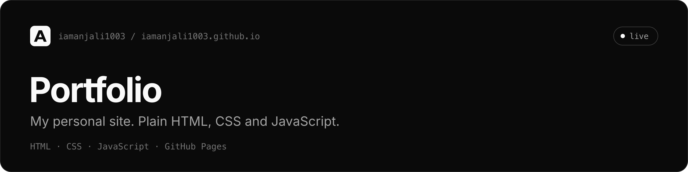

My personal site: a single page in plain HTML, CSS and JavaScript, published with GitHub Pages.

[Live](https://iamanjali1003.github.io)

## Overview

One page with sections for experience, projects, skills, achievements, education
and contact. There is no framework, no build step and no package manager, so what
is in this repository is exactly what the browser receives.

## Features

- Monochrome design built on shadcn/ui's neutral tokens, with no accent colour
- Light and dark themes that follow the system setting, with a toggle that is remembered
- The theme is applied before the page paints, so there is no flash on load
- On phones, the section links become a row that scrolls sideways under the header
- Lucide icons in one SVG sprite, loaded once and cached
- Open Graph and Twitter cards, `schema.org/Person` JSON-LD, `robots.txt` and `sitemap.xml`
- Skip link, landmark elements, visible focus rings, and `prefers-reduced-motion` support

## Tech stack

| Area | Choice |
| --- | --- |
| Markup | HTML5 |
| Styling | Hand-written CSS on shadcn/ui design tokens |
| Scripts | Plain JavaScript, no dependencies |
| Icons | [Lucide](https://lucide.dev), as an SVG sprite |
| Fonts | Inter, JetBrains Mono |
| Hosting | GitHub Pages |

## How it works

The styles are split by job and loaded in order, each building on the last:

```
tokens.css      colours, radius, fonts      the only place a colour is defined
   |
base.css        reset, type, focus, icons   rules every element gets
   |
components.css  nav, buttons, cards, tags   pieces used in more than one place
   |
sections.css    hero, sections, footer      page layout and the phone breakpoint
```

Two scripts. `theme.js` loads in the `<head>` and sets `data-theme` before
anything is drawn. `main.js` loads at the end of the page and handles the theme
toggle, the footer year, and the scroll-spy that highlights the section you are
reading.

## Getting started

The icon sprite is a separate file, which browsers only load over HTTP, so serve
the folder rather than opening `index.html` directly:

```bash
git clone https://github.com/iamanjali1003/iamanjali1003.github.io.git
cd iamanjali1003.github.io
python3 -m http.server 8000
```

Then open <http://localhost:8000>.

## Project structure

```
.
├── index.html
├── assets/
│   ├── css/
│   │   ├── tokens.css        design tokens, light and dark
│   │   ├── base.css          reset, typography, accessibility
│   │   ├── components.css    nav, buttons, badges, cards, tags
│   │   └── sections.css      page sections and the phone layout
│   ├── js/
│   │   ├── theme.js          sets the theme before first paint
│   │   └── main.js           toggle, footer year, scroll-spy
│   ├── brand/
│   │   ├── mark.svg          the monogram, used as the favicon
│   │   └── apple-touch-icon.png
│   └── icons.svg             Lucide icon sprite
├── og-image.png              1200 x 630 social preview
├── robots.txt
└── sitemap.xml
```

## Deployment

GitHub Pages serves the `main` branch. Pushing to `main` publishes the site.

## License

[MIT](LICENSE) © 2026 [Anjali](https://iamanjali1003.github.io)
