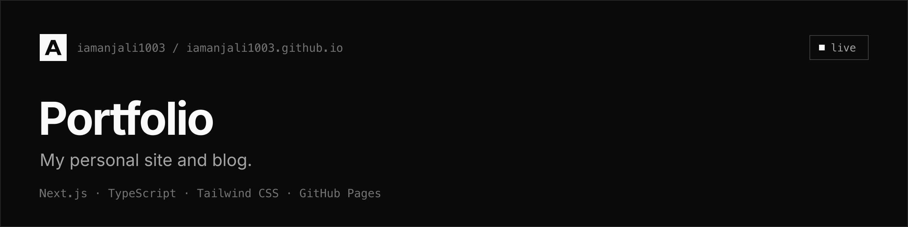

My personal site and blog, built with Next.js and shadcn/ui and published on GitHub Pages.

[Live](https://iamanjali1003.github.io) · [Blog](https://iamanjali1003.github.io/blog/) · [RSS](https://iamanjali1003.github.io/feed.xml)

## Stack

Next.js 16 (static export) · TypeScript · Tailwind CSS v4 · shadcn/ui · MDX · GitHub Actions

## Run it

```bash
pnpm install
pnpm dev        # http://localhost:3000
pnpm build      # writes the static site to out/
```

## Pages

| Path | What's there |
| --- | --- |
| `/` | Intro, featured projects, experience and education, skills, latest PRs and posts |
| `/projects/` | Every project, filtered by area |
| `/open-source/` | Pull requests to other projects, grouped, with their status |
| `/blog/` and `/blog/<slug>/` | Posts, written in MDX |
| `/about/` | Experience, education, achievements and skills |

Every page also has a share image at `<page>/og.png`, drawn at build time.
`/feed.xml`, `/sitemap.xml`, `/robots.txt` and `/manifest.webmanifest` are
generated too.

## Edit it

| To change | Edit |
| --- | --- |
| Name, links, top menu, SEO defaults | `src/config/site.ts` |
| A page's title and description | `src/config/pages.ts` |
| Intro and "At a glance" | `src/content/profile.ts` |
| Projects (`featured: true` puts one on the home page) | `src/content/projects.ts` |
| Pull requests | `src/content/open-source.ts` |
| Experience, education, skills, achievements | `src/content/*.ts` |

## Write a post

Add `src/content/blog/<slug>.mdx`:

```mdx
---
title: "The title"
description: "One or two sentences for the blog list and search results."
date: "2026-12-01"
---

Write in Markdown. `## Headings` become the table of contents.
```

The post gets its page, its share image, a place in the RSS feed and the
sitemap, and a reading time. Code blocks are highlighted; add
`title="Before"` after the language for a caption. Add `draft: true` to keep a
post out of the build.

## Structure

```
src/
  app/          routes, each page next to its og.png route
  components/
    ui/         shadcn/ui components
    layout/     header, menus, search, theme, footer
    home/       home page sections
    projects/   project cards and filter
    open-source/ pull request list, table and status badge
    blog/       post cards, MDX rendering, table of contents
    resume/     experience, education and skills blocks
    shared/     pieces used across sections
  config/       site settings and page titles
  content/      everything the site says, and blog/*.mdx
  lib/          posts, SEO metadata, structured data, share images
```

## Deploy

Pushing to `main` lints, type-checks, builds and publishes to GitHub Pages.
Settings → Pages → Source must be "GitHub Actions". Dependabot opens weekly
pull requests for outdated or vulnerable packages.

## License

[MIT](LICENSE) © 2026 [Anjali](https://iamanjali1003.github.io)
